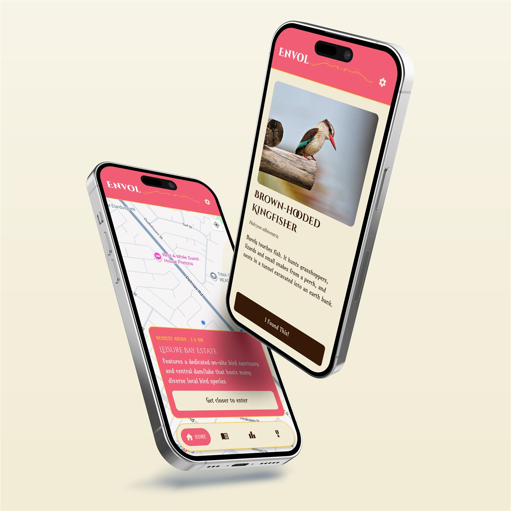

# Envol


Envol turns birdwatching into a race. Travel to a real place, find every bird that lives there, and prove each sighting with a photo — before the clock runs out, or faster than anyone else.

*Envol* is French for taking flight.

**[Watch the demo](#demo-video) · [What it does](#what-it-does) · [Design](#design) · [Run it yourself](#run-it-yourself) · [How it's built](#how-its-built)**

> DV 300 — Term 3 project. Open Window Institute.

---

## Contents

- [Try it](#try-it)
- [What it does](#what-it-does)
  - [Race at real places](#race-at-real-places)
  - [Two ways to race](#two-ways-to-race)
  - [Prove you saw it](#prove-you-saw-it)
  - [Your ledger, the leaderboard and medals](#your-ledger-the-leaderboard-and-medals)
  - [Everything else](#everything-else)
- [Design](#design)
- [Tech stack](#tech-stack)
- [Run it yourself](#run-it-yourself)
- [Project structure](#project-structure)
- [Data model](#data-model)
- [How it's built](#how-its-built)
- [Security model](#security-model)
- [Constraints and trade-offs](#constraints-and-trade-offs)
- [Known limitations and future work](#known-limitations-and-future-work)
- [Checking the code](#checking-the-code)
- [Credits](#credits)
- [Demo video](#demo-video)

---

## Try it

Envol isn't on an app store. There are two ways to see it:

| Option | What you get |
| --- | --- |
| [Watch the demo video](#demo-video) | A full race, start to finish, recorded on a phone. |
| [Run it yourself](#run-it-yourself) | The real app on your own phone through Expo Go. You'll need to be standing inside an arena to race. |

> [!NOTE]
> Arenas only unlock when your phone's GPS puts you inside them. If there's no arena near you, the map still loads, but the race won't start. To test from home, add an arena at your own location (see [Seeding data](#seeding-data)).

---

## What it does

<p align="center">
  
</p>

### Race at real places

The map shows nearby **arenas**: real places such as nature reserves and estates, each with its own list of birds. Walk into one and it unlocks. The Ledger and Leaderboard tabs follow you too: they always show the arena you're standing in.

### Two ways to race

| Mode | Timer | Ends when |
| --- | --- | --- |
| Stopwatch Sprint | Counts up, no limit | Every species found, or the player finishes |
| Countdown Challenge | Counts down from 30 minutes, 1 hour or 2 hours | Time runs out, every species found, or the player finishes early |

The clock keeps running while you move between the map, the ledger and species pages. A small timer follows you around and taps back into the race. Sprints can be paused; Countdown runs deliberately cannot.

| Map | Race in progress |
| --- | --- |
|  |  |

### Prove you saw it

A bird only counts once you supply a photo of it taken **today**. Envol reads the photo's EXIF `DateTimeOriginal` and rejects anything without one: screenshots, downloads, and anything forwarded through a messaging app. The photo is checked and then discarded; nothing is stored. Photos from a dedicated camera work too, as long as they're from today.

| Species detail |
| --- |
|  |

### Your ledger, the leaderboard and medals

- **Ledger.** Every bird you've found in an arena, with a progress bar. Birds you haven't found yet stay hidden until you see them in the field. Countdown finds count here too, so timed runs still build your permanent record.
- **Leaderboard.** Per arena, split by mode, and split again by duration within Countdown, because a score only means something against the same clock. Ranked by species found, with time as the tiebreaker. Sprint shows how long the run took; Countdown shows how much time was left.
- **Medals.** Eight achievements earned from how you play: Early Bird, Night Owl, Weekend Warrior, Speed Demon, First Blood, Explorer, Comeback and Marathoner. Pick one as your favourite and it appears beside your name on the leaderboard.

<p align="center">
  
  
  
  
  
  
  
  
</p>

| Ledger | Leaderboard | Medals |
| --- | --- | --- |
|  |  |  |

### Everything else

- **Seasonal colours.** The app's accent colour follows the South African season, or can be pinned in Settings.
- **Your profile.** Set a display name and a profile picture, which show on the leaderboard.
- **Landscape and tablets.** Every screen works sideways and on larger screens.
- **Loading states.** Screens show a skeleton of their layout while data loads, instead of a blank page or a false "no arena nearby".
- **Account.** Email sign-up, with a show-password toggle and password change in Settings.

---


## Design

Envol is meant to feel like an old field guide: warm paper, a decorative serif title and handwritten-feeling body text, with one bold colour that changes with the season.

**Type**

| Role | Font |
| --- | --- |
| Logo and headings | Cinzel Decorative |
| Body text | Amarante |
| Scientific names | Tinos, italic, as a field guide prints them |

**Colour**

| Token | Colour | Used for |
| --- | --- | --- |
| Paper | `#F0EBD4` | Backgrounds |
| Ink | `#361A07` | Text and primary buttons |
| Gold | `#FBCE3D` | Borders and highlights |
| Spring | `#F15D73` | Accent, September–November |
| Summer | `#407700` | Accent, December–February |
| Autumn | `#680303` | Accent, March–May |
| Winter | `#3A5987` | Accent, June–August |

Icons are Material Icons, drawn through a single `IconSymbol` component, so there are no emojis anywhere in the interface.

<!-- Feature mockup: export it as PNG to frontend/assets/screenshots/mockup-features.png, then uncomment the block below. -->
<!--
<p align="center">
  
</p>
-->

---

## Tech stack

| Concern | Choice |
| --- | --- |
| Framework | React Native 0.81 via Expo SDK 54 |
| Language | TypeScript |
| Navigation | Expo Router (file-based, typed routes) |
| Backend | Firebase — Authentication and Cloud Firestore |
| Maps | `react-native-maps` |
| Location | `expo-location` |
| Camera / photos | `expo-image-picker`, `expo-image-manipulator` |
| Fonts | Cinzel Decorative, Amarante, Tinos via `@expo-google-fonts` |

---

## Run it yourself

You'll need Node.js 18+ and the **Expo Go** app on a physical phone. Location and camera features need real hardware, so an emulator won't get you far.

```bash
git clone https://github.com/corbyn-jpg/envol.git
cd envol/frontend
npm install
npm start
```

Scan the QR code with Expo Go (Android) or the Camera app (iPhone).

> [!TIP]
> `npm run start:web` opens a browser build, which is handy for checking layouts, but the map and camera won't work there.

### Firebase setup

The client configuration lives in `lib/firebase.ts`. To point the app at your own Firebase project, replace that object and enable:

- **Authentication** with the Email/Password provider
- **Cloud Firestore**

Then publish security rules — see [Security model](#security-model) below.

### Seeding data

Arenas and their bird species are not created by the app; they must exist in Firestore before anything is playable. Create at least one `arenas` document with a `birds` subcollection following the shapes in [Data model](#data-model).

Field names inside `birds` documents contain spaces (`common name`, `scientific name`, `fun fact`), which is why the code reads them with bracket notation rather than dot access.

---


## Project structure

```
frontend/
  app/                    Screens — every file is a route
    (auth)/               Login and signup, shown when signed out
    (tabs)/               Map, Ledger, Leaderboard, Medals
    arena/                Race entry (mode select) and the active race
    species/              Species detail and photo verification
    settings.tsx          Display name, profile picture, theme, password
  components/             Banner, tab bar, mini timer, skeletons, themed text
  contexts/               Auth, theme and race-timer providers
  hooks/                  use-nearby-arena — shared GPS/arena resolution
  lib/                    Firebase init, medals, game modes, distance,
                          season, photo verification
  constants/theme.ts      Colours, fonts, seasonal palette, layout limits
  assets/badges/          Medal artwork
```

---

## Data model

```
users/{uid}
  displayName, photoUrl, favouriteMedalId, themePreference

users/{uid}/raceProgress/{progressKey}
  foundSpeciesIds[], foundAt{speciesId: timestamp},
  startedAt, accumulatedSeconds, completed

arenas/{arenaId}
  name, province, description, location (geopoint),
  radiusMeters, firstCompletedBy

arenas/{arenaId}/birds/{speciesId}
  "common name", "scientific name", imgURL, "fun fact"

raceResults/{resultId}
  userId, displayName, arenaId, mode, limitSeconds,
  totalSeconds, speciesFound, completedAt
```

**The `progressKey` is the interesting part.** Sprint progress is stored under the bare `arenaId`; Countdown uses `{arenaId}_countdown_{limitSeconds}`. Without that separation, playing both modes in one arena would share a single found-birds list and clock. Sprint deliberately kept the original key so progress saved before Countdown existed still loads.

---


## How it's built

**Arenas use real distance.** Each arena has a coordinate and a radius. The `use-nearby-arena` hook compares the phone's GPS position against every arena with the haversine formula and only unlocks one once the player is physically inside it. The Map, Ledger and Leaderboard all share that hook, so they always agree on where you are.

**The race timer is a context, not screen state.** A timer owned by the race screen would reset every time the player navigated to a species page and back. Instead `RaceProvider` tracks a start timestamp plus banked seconds, and elapsed time is derived from `Date.now()` rather than accumulated by an interval, so the clock stays accurate even if the ticking is throttled. Countdown is the same value subtracted from a limit, which means countdown needed no new timing logic at all.

**Completion is detected, not triggered.** A race can end without the player pressing anything: the last species gets logged on the detail screen, or the clock reaches zero. Recording is therefore driven by derived state (`isFullyComplete || isTimeUp`) rather than by a button handler, with a guard flag preventing a double write.

**Denormalised display names.** `raceResults` stores the player's name at completion time so the leaderboard has a fallback without an extra read, but the leaderboard prefers the live value from `users/{uid}`. Otherwise renaming yourself would leave stale names scattered across old results, and the results are immutable by design.

**Medals are derived, not awarded.** Nothing writes "you earned Early Bird". `lib/medals.ts` defines each medal as a predicate over the player's race history, evaluated on render. Adding a medal means adding one entry to an array. The trade-off is that medal logic depends on history staying available.

**A shared max content width.** Every screen caps its content at 560px and centres it. This is what makes landscape and tablet layouts hold together instead of stretching list rows across the full viewport.

---

## Security model

The Firebase config in `lib/firebase.ts` is **not a secret**. Client-side Firebase keys identify the project; they do not grant access. Every meaningful restriction is enforced server-side by Firestore rules, which is where the real security lives.

Rules this app depends on:

- `raceResults` — a user may only create a result carrying their own `userId`, and results are immutable once written (no update, no delete), so scores cannot be edited after the fact.
- `arenas` — readable by everyone, but writable only for the `firstCompletedBy` field, and only when it has not already been set. That makes the First Blood medal a genuine race rather than something any client can claim.
- `users/{uid}` — a user may only write their own document.

The one credential that would need protecting is an Anthropic API key, had the AI verification path been taken — see below.

---


## Constraints and trade-offs

**Cloud Storage requires a paid Firebase plan**, so profile pictures could not be uploaded conventionally. Instead images are cropped square, resized to 256px, JPEG-compressed and stored as a base64 data URI on the user document. That keeps the feature on the free tier at the cost of roughly 15–25KB per user, and it works because a data URI is accepted anywhere an image URL is. Size discipline matters here: the leaderboard reads every displayed racer's user document.

**Photo verification: metadata over AI.** The stronger design would send each photo to a vision model to confirm it shows the expected species. That was costed and prototyped: roughly R0.25 per verification, requiring a serverless proxy to hold the API key, since embedding it in the app would let anyone extract and spend it. Metadata validation was chosen instead as a free, offline, zero-infrastructure check that still defeats the most common cheats. Its honest limit is that it proves *when* a photo was taken, not *what it shows*.

**In-app capture was considered and rejected.** Forcing the camera would make the timestamp unfakeable, but it would also exclude photographs taken on a dedicated camera, a real use case for birdwatchers. Trusting metadata is the cost of supporting them.

**Google Sign-In needs a development build.** Native Google sign-in can't run inside Expo Go, and moving to a development build would change how everyone tests the app, so it was left for later.

---

## Known limitations and future work

- **EXIF timestamps are editable.** The check raises the effort bar considerably but is not tamper-proof. It is a deterrent, not a security boundary.
- **Pixel analysis** would close the gap metadata cannot: confirming the photo shows the right species, detecting photographs of a screen, and catching near-duplicate images passed between players.
- **Duplicate photo detection** — hashing accepted photos would stop one good photograph being shared around a group, a cheat no image analysis catches because the photo is genuine.
- **Medals count Countdown results.** They were intended to be Sprint-only, since a fixed time limit makes duration-based medals like Speed Demon trivial to earn.
- **Google Sign-In** was deferred; it requires leaving Expo Go for a development build.
- **No offline support.** Every screen assumes a live Firestore connection.
- **No automated tests yet.** The game-mode maths, medal predicates and EXIF date parsing are pure functions and the obvious first candidates.

---

## Checking the code

```bash
cd frontend
npx tsc --noEmit    # type-check
npm run lint        # Expo's ESLint config
```

---

## Credits

- **Fonts:** Cinzel Decorative and Amarante (SIL Open Font License), Tinos (Apache License 2.0), via Google Fonts.
- **Icons:** Material Icons via `@expo/vector-icons` (Apache License 2.0).
- **Bird photographs:** [add photo credits here].

Built by [@corbyn-jpg](https://github.com/corbyn-jpg) for DV 300 at Open Window.

---


## Demo video

[Watch the walkthrough on Google Drive](https://drive.google.com/drive/folders/1xB-WG3HAU4v7MIL8T4z9ltn_a5msdfLC?usp=drive_link)
